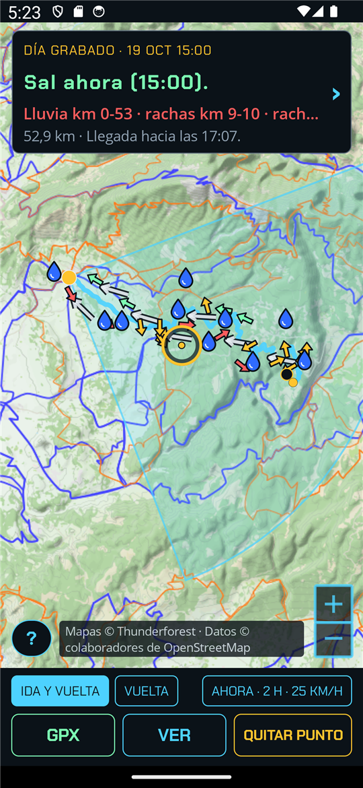
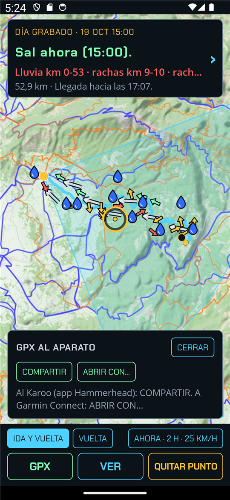
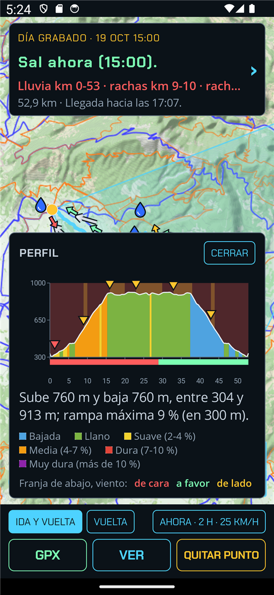

<p align="center">
  
</p>

<h1 align="center">VientoHud</h1>

<p align="center">
  <b>Antes de salir en bici: ¿salgo, cuándo y por dónde?</b><br/>
  Mira el viento y la lluvia de ese momento, te dice hacia dónde conviene ir, trazas la ruta tocando el mapa y te la lleva al GPS de la bici en GPX.
</p>

<p align="center">
  
  
  <a href="https://github.com/victorvalenciamunoz/VientoHud/actions/workflows/ci.yml"></a>
  
  
  <a href="LICENSE"></a>
</p>

---

## Qué es

Solo bici de carretera, y nada de teclear: la ubicación sale del móvil y lo demás se elige tocando.

1. **Hacia dónde.** Con el viento previsto para las horas de la salida, la app dice hacia dónde conviene empezar (ida de cara, vuelta a favor) y lo pinta como un abanico en el mapa.
2. **Por dónde.** Mantienes pulsado un punto del mapa (ida y vuelta) o dos o más (vuelta por ellos). Una petición a BRouter por carreteras asfaltadas, y en segundos: el sentido mejor para el viento, el viento tramo a tramo a la hora a la que pasarás (flechas de colores), la lluvia prevista en la ruta (radar a corto plazo y modelo después), los km de ciudad y la hora de llegada.
3. **Cuándo.** "Sal ahora" o "mejor espera hasta las…" si así te mojas menos o evitas rachas de lado peligrosas. También puedes elegir la hora de salida de hoy.
4. **El GPX es el producto.** La ruta, con el resumen y avisos en los puntos que importan, va al GPS de la bici (Hammerhead, Garmin o cualquiera). El móvil se queda guardado.

| La ruta, con el viento y la lluvia | El GPX, al aparato | El perfil |
| --- | --- | --- |
|  |  |  |

Capturas en el emulador con un día grabado (19 de octubre de 2026, al pie del Mont Ventoux): la app vive aquel
momento con la previsión y el radar que había entonces.

Hermano de [CieloHud](https://github.com/victorvalenciamunoz/CieloHud) y GincanaHud: misma estética, mismos principios.

## Datos y servicios

Sin servidor propio: todo son servicios y datos públicos, detrás de interfaces y con sus licencias en
[`THIRD-PARTY-NOTICES.md`](THIRD-PARTY-NOTICES.md).

| Pieza | Fuente |
|---|---|
| Viento y lluvia por horas | [Open-Meteo](https://open-meteo.com) (AROME en España, otros modelos de reserva) |
| Lluvia a corto plazo | Radar de [EUMETNET OPERA](https://www.eumetnet.eu/activities/observations-programme/current-activities/opera/) (Open Radar Data), movido hacia delante |
| Rutas | [BRouter](https://github.com/abrensch/brouter) con un perfil propio de bici de carretera sobre datos de OpenStreetMap |
| Mapa de fondo | OpenCycleMap de [Thunderforest](https://www.thunderforest.com) (con clave) o, sin clave, OpenStreetMap |

Y el tiempo es el juez: cada fase se ha contrastado con lo que pasó de verdad (estaciones, METAR, imágenes de radar
posteriores). Las decisiones y cómo se comprobó cada una están en [`docs/DECISIONS.md`](docs/DECISIONS.md); el detalle de
esas comprobaciones, con datos de sitios reales, se queda fuera del repo.

## Estructura

| Proyecto | Qué es |
|---|---|
| `src/VientoHud.Core` | Todo el cálculo, sin interfaz: viento, radar y lluvia, rutas, puntuación, textos y GPX. |
| `src/VientoHud.Console` | Consola para validar y para los jueces (`wind`, `route`, `trace`, `radar`, `verify`). Solo formatea lo que devuelve Core. |
| `src/VientoHud.App` | La app .NET MAUI para Android. Solo muestra lo que devuelve Core. |
| `tests/VientoHud.Core.Tests` | xUnit, con servicios falsos y respuestas reales grabadas. Las que dependen de sitios reales se quedan fuera del repo y solo corren en el equipo del autor. |
| `docs/` | [Visión](docs/VISION.md), [plan por fases](docs/PLAN.md), [estado](docs/STATUS.md) y [decisiones](docs/DECISIONS.md), en español. |

## Compilar y probar

Hace falta el SDK de .NET 10 (`global.json` fija la versión) y, para la app, la carga de trabajo de Android.

```bash
dotnet build                      # Core, consola, tests y app (la app tarda un poco más)
dotnet test                       # los tests de Core
dotnet build src/VientoHud.App    # solo la app Android
```

La consola, por ejemplo, para una ruta trazada por un punto (las coordenadas son de ejemplo):

```bash
dotnet run --project src/VientoHud.Console -- trace --lat 45.0 --lon 1.0 --via "45.05,1.3"
```

Claves y servicios, nunca en el repo:

- `VIENTOHUD_THUNDERFOREST_KEY`: clave de Thunderforest, leída al compilar la app. Sin ella, el mapa es OpenStreetMap.
- `VIENTOHUD_BROUTER_URL`: un BRouter propio para la consola (por defecto, brouter.de). Durante el desarrollo conviene uno local (p. ej. en el puerto 17777) para no cargar el servidor público.
- `VIENTOHUD_APP_BROUTER_URL`: lo mismo para la app, leído al compilar (desde el emulador, `http://10.0.2.2:17777/`).

## Instalar en tu móvil

Descarga el APK de la [última versión](https://github.com/victorvalenciamunoz/VientoHud/releases) desde el propio móvil
(Android 8.0 o posterior) y ábrelo. Android pedirá permiso para instalar apps de origen desconocido, y Play Protect
puede avisar de que no la conoce: es normal en una app que no está en Google Play.

Al abrirla pedirá la **ubicación** (es el punto de salida; no sale del móvil salvo para pedir el tiempo y las rutas).
Necesita conexión: la previsión, el radar, las rutas y el mapa vienen de servicios públicos. Las versiones 0.x son
*pre-release*: la fase 7 sigue abierta y conviene contrastar lo que dice con lo que luego pasa en la carretera.

## Llevar la ruta al GPS de la bici

Con la ruta trazada y juzgada (viento y lluvia dentro), el botón **GPX** junto a DETALLE abre el panel "GPX al aparato".
El fichero lleva el consejo entero en la descripción y los avisos de rachas y lluvia como puntos de paso.

### Hammerhead Karoo

1. **COMPARTIR**.
2. En la hoja de Android, elige **Karoo Companion** (la app de Hammerhead).
3. "Enviando a Karoo" y "Carga completa": la ruta ya está en tu lista de rutas de Hammerhead, y el Karoo la
   descarga por wifi o por la app.

Vale igual para cualquier otra app que acepte un GPX compartido (Strava, komoot, Drive, el correo…).

### Garmin (Fenix, Edge…)

1. **ABRIR CON…**. Garmin Connect no sale en la hoja de compartir: solo acepta "abrir con". Si tienes varias apps que
   abran GPX, Android pregunta cuál; si solo está Garmin Connect, se abre directamente.
2. Garmin Connect pide el tipo de trayecto: **Ciclismo en ruta**.
3. Muestra la ruta; con **Guardar** queda en tus trayectos, para mandarla al reloj o al ciclocomputador.

## Estado

Diez fases: nueve cerradas y la 7 (la app Android), abierta solo por su juez: salidas reales con la app. Lo que está
en marcha, en [`docs/STATUS.md`](docs/STATUS.md).

## Licencia

MIT, ver [`LICENSE`](LICENSE). Las fuentes, datos y servicios de terceros tienen las suyas:
[`THIRD-PARTY-NOTICES.md`](THIRD-PARTY-NOTICES.md).
